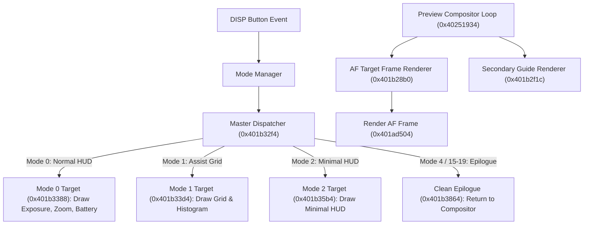

# Olympus SP-550UZ Firmware Architecture & Reverse Engineering Reference

**Target Model:** Olympus SP-550UZ (Internal OEM Platform: Sanyo `SG155`, Build `v155-77`, DVR `77`)  
**Hardware Code:** `SANE321000000000` (`07b4:0109`)  
**Firmware Image Base:** `0x40000000` (ARM Little-Endian, ARMv5TEJ)  
**Document Purpose:** Comprehensive technical reference of the internal operating system, hardware register mapping, image pipeline, and subsystem entry points.

---

## 1. System Architecture & Memory Map

The SP-550UZ is built on the **Sanyo Coach / Olympus TruePic III** digital signal processing (DSP) application-specific integrated circuit (ASIC), pairing an ARM core with dedicated hardware DMA, JPEG/YUV coprocessors, and a CCD sensor timing generator.

### 1.1 Memory Map
| Physical Address Range | Size | Bus / Domain | Description |
| :--- | :--- | :--- | :--- |
| `0x40000000` – `0x403F50E7` | ~4.15 MB | SDRAM (Cached) | **Section 1 ("NPROG")** — Executable ARM program code and literal pools |
| `0x403F5108` – `0x40855967` | ~4.59 MB | SDRAM / Flash | **Section 2 ("NDATA")** — Fonts, GUI bitmaps, shutter sounds, color palettes |
| `0x41F00000` – `0x41F7FFFF` | 512 KB | SDRAM (Uncached) | Heap, DMA transfer buffers, framebuffers |
| `0x41F80000` – `0x41F9FFFF` | 128 KB | SDRAM | **Global System Structures** (`0x41f8ddcc` main state, `0x41f8ddac` idle timer) |
| `0x41FA0000` – `0x41FCFFFF` | 192 KB | SDRAM | Task stacks (IRQ, FIQ, Abort, Undefined, Supervisor) |
| `0x41FD0000` | — | SDRAM | System / User Mode top of stack |
| `0x80410000` – `0x8041FFFF` | 64 KB | MMIO | SDRAM Controller & Memory Timing Config |
| `0xC04C0000` – `0xC04CFFFF` | 64 KB | MMIO | Direct Memory Access (DMA) & NAND Flash Controller |
| `0xE0010000` – `0xE081FFFF` | 8 MB | MMIO | Timers, Interrupt Controller, Video DAC, GPIO Keypad, ISP |

### 1.2 Processor Configuration (`0x40000800`)
At cold boot, the reset vector jumps to `0x40000800`, configuring the ARM core's banked registers:
* **IRQ Mode (`CPSR 0xd2`):** Stack initialized to `0x41fcf000`
* **Supervisor Mode (`CPSR 0xd3`):** Stack initialized to `0x41fcf000`
* **Abort Mode (`CPSR 0xd7`):** Stack initialized to `0x41fcf000`
* **Undefined Mode (`CPSR 0xdb`):** Stack initialized to `0x41fcf000`
* **System / User Mode (`CPSR 0xdf`):** Stack initialized to `0x41fd0000`
* CP15 coprocessor register 1 configured with I-Cache and D-Cache enabled via `mrc/mcr p15, #0, r1, c1, c0, #0`.

---

## 2. Firmware Container & Obfuscation Format

The firmware is distributed in an obfuscated `.BIN` container (`SAN_E_321_1100_0000_0000.BIN`, 8,739,184 bytes). It is **not** encrypted with DES or RSA, but rather scrambled using a deterministic block permutation and bitwise inversion.

### 2.1 De-obfuscation / Scrambling Algorithm
The entire container is partitioned into aligned **16-byte blocks**.
```python
# Unscrambling (from official binary to plaintext):
PERM16 = [2, 0, 3, 1, 5, 7, 4, 6, 11, 10, 9, 8, 14, 12, 13, 15]
plain[blk + i] = scrambled[blk + PERM16[i]] ^ 0xFF

# Scrambling (from plaintext to official binary):
INV_PERM16 = [1, 3, 0, 2, 6, 4, 7, 5, 11, 10, 9, 8, 13, 14, 12, 15]
scrambled[blk + j] = plain[blk + INV_PERM16[j]] ^ 0xFF
```

### 2.2 Container Layout
```text
+--------------------------------------------------------------------------+
| 96-Byte ASCII Header: Section 1 ("NPROG")                                |
| LENGTH=4149416 SG155 VER=v155-77 DVR=77 SUM=445413452 NDATA\r\n [spaces] |
+--------------------------------------------------------------------------+
| Section 1: 4,149,416 Bytes (ARM Program Binary, Base 0x40000000)         |
+--------------------------------------------------------------------------+
| 96-Byte ASCII Header: Section 2 ("NDATA")                                |
| NDATA LENGTH=4589568 SG155 VER=v155-77 DVR=77 SUM=480118548\r\n [spaces]  |
+--------------------------------------------------------------------------+
| Section 2: 4,589,568 Bytes (GUI Bitmaps, Sounds, Palettes, Fonts)        |
+--------------------------------------------------------------------------+
| 8-Byte Padding (\x00\x00\x00\x00\x00\x00\x00\x00) -> 16-byte alignment   |
+--------------------------------------------------------------------------+
```

### 2.3 Checksum Verification
The camera bootloader verifies each section using an unsigned 32-bit byte summation:
$$\text{SUM} = \sum_{i=0}^{\text{length}-1} \text{byte}[i] \pmod{2^{32}}$$
Any modification to Section 1 requires recomputing this sum and embedding it into the ASCII header string before repacking. Verified by [`sp550uz_fw_pack.py`](../scripts/sp550uz_fw_pack.py).

---

## 3. Operating System & Global State Architecture

The camera runs an event-driven real-time executive derived from μITRON concepts, featuring cooperative and preemptive tasks, inter-task mailboxes, and hardware timer ticks.

### 3.1 The Master State Structure (`0x41f8ddcc`)
Every module in the firmware accesses the central system state structure at RAM address `0x41f8ddcc`:

| Struct Offset | Type | Name / Function | Observed Values |
| :--- | :--- | :--- | :--- |
| `+0x46` | `uint8` | Subsystem Status | `0` = Ready, `1` = Busy |
| `+0x5a` | `uint16` | **Display Output Destination** | `0` = LCD, `1` = EVF, `4` = NTSC Video Out, `6` = PAL Video Out |
| `+0x60` | `uint32` | **Major Operating Mode** | `4` = Shooting (Rec), `6` = Playback, `0x0c` = Voice, `0x49` = Sleep, `0xe7` = USB |
| `+0x7f` | `uint8` | UI State Flag | `0` = Idle, `1` = Active menu |
| `+0x8a` | `uint8` | Flash Subsystem State | Internal strobe capacitor charge status |
| `+0x91` | `uint8` | Shooting Mode Category | `1` = Auto, `2` = Program, `5` = Scene, `8` = Movie, `0x0b` = Guide |
| `+0x9c` | `int8` | **OSD Display Mode** | `0` = Normal HUD, `1` = Grid/Histogram, `2` = Minimal HUD View, `5` = Custom |
| `+0x9e` | `uint8` | Active Scene Selection | Numerical scene ID (Portrait, Landscape, Night, Sport) |
| `+0xa5` | `uint8` | OSD Display Mute Flag | `0` = Show overlays, `1` = Force hide overlays |

### 3.2 Inactivity & Power Management Task (`0x41f8ddac`)
* **Idle Counter:** RAM address `0x41f8ddac` is an unsigned 32-bit countdown value (initialized to `1500` ticks = 2.5–3 minutes).
* **Reset Handler (`0x401501b4`):** Called whenever any button is pressed or dial rotated:
  ```arm
  strh r0, [0x403ea8e4]
  str  r0, [0x41f8ddac]     ; resets countdown
  ```
* **Hardware Key Polling (`0x401247fc`):** Scans matrix lines for power button, shutter half-press, full-press, zoom in/out, 4-way arrow keys, OK, MENU, and DISP.
* **Sleep Inhibit Query (`0x40150540`):** Polled before entering sleep. Returning `1` forces the system to branch past sleep/shutdown routines.

---

## 4. Subsystem Breakdown & Key Entry Points

### 4.1 On-Screen Display (OSD) Engine (`DISP_*`, `OSC_*`)
The OSD pipeline renders characters and bitmap layers onto a hardware overlay plane that the video DAC composites on top of the live sensor feed.



* **Master Record Mode Dispatcher ([`0x401b32f4`](file:///home/justin/Dev/olympus/Resources/firmware/sp550uz_v1.1_section1_code.bin#L1)):** Uses a 25-entry branch table at `0x401b3324` routing HUD display modes (Full HUD, Grid/Histogram, Minimal, Scene Guide).
* **AF Target Frame Renderer ([`0x401b28b0`](file:///home/justin/Dev/olympus/Resources/firmware/sp550uz_v1.1_section1_code.bin#L1)):** Primary preview loop function that renders the central AF frame and brackets.
* **Secondary Guide Renderer ([`0x401b2f1c`](file:///home/justin/Dev/olympus/Resources/firmware/sp550uz_v1.1_section1_code.bin#L1)):** Renders secondary alignment guides and focus confirmation indicators.
* **Direct AF Box Renderer ([`0x401ad504`](file:///home/justin/Dev/olympus/Resources/firmware/sp550uz_v1.1_section1_code.bin#L1)):** Primitive routine that draws the AF target rectangle into the OSD framebuffer.
* **Central Element Renderer ([`0x401b3874`](file:///home/justin/Dev/olympus/Resources/firmware/sp550uz_v1.1_section1_code.bin#L1)):** Dispatches HUD element text and icons to the active frame buffer.
* **Menu Rendering Engine ([`0x401cf000`](file:///home/justin/Dev/olympus/Resources/firmware/sp550uz_v1.1_section1_code.bin#L1)):** Separate subsystem (`DISP_GUI_*`, `DISP_GuiLib_*`) utilizing Section 2 bitmaps.

### 4.2 Power & Sleep Management
* **Hardware Timer Query ([`0x40184be0`](file:///home/justin/Dev/olympus/Resources/firmware/sp550uz_v1.1_section1_code.bin#L1)):** Checks composite video cable detection (`0x4016a340() == 1`). If connected, returns `r0=1`, setting timer packet threshold `sp[6] = 0` (hardware sleep timer disabled).
* **Primary Idle Sleep Transition ([`0x4014b264`](file:///home/justin/Dev/olympus/Resources/firmware/sp550uz_v1.1_section1_code.bin#L1)):** Dispatched by event `0xca0f`. Calls `0x40184be0`; aborts sleep transition if `r0 >= 1`.
* **Secondary Idle Sleep Transition ([`0x4014bb18`](file:///home/justin/Dev/olympus/Resources/firmware/sp550uz_v1.1_section1_code.bin#L1)):** Dispatched by event `0xca07`. Calls `0x40184be0`; aborts sleep transition if `r0 >= 1`.
* **Temporary Off (`TmpOff` at `0x401abd2c`):** Handles display blanking and intermediate sensor power-down.
* **Physical Shutdown ([`0x4014bfc0`](file:///home/justin/Dev/olympus/Resources/firmware/sp550uz_v1.1_section1_code.bin#L1)):** Retracts lens motor, flushes NAND flash buffers, and cuts system power rails.

### 4.3 Sensor Pipeline & ISP
* **Throughput / Passthrough Controller (`REC_ThroughCtrl` at `0x40176b38`):** Sets up continuous CCD subsampled draft streaming to DRAM buffers for 30 fps video out.
* **YUV Buffer Clocks (`SYSFNC_FMT_set_BufA_clock` at `0x400d4ac0`):** Configures pixel clock dividers for NTSC (29.97 fps) and PAL (25 fps) composite DAC rasterization.
* **Dead Pixel Defect Mapping (`anji_hakuten_pos`, `meiji_kokuten_pos` at `0x402b8000`):** Factory calibration tables storing row/column coordinates of dead/hot CCD pixels to interpolate around them in hardware.

### 4.4 Storage & Filesystem Subsystem
* **Filesystem Engine:** Tokyo Electron Device Ltd. FAT12/FAT16 FSB library (v1.2.1) with support for xD-Picture Card (NAND flash) and internal 47 MB system flash memory.
* **NAND Translation Layer:** Samsung-style block management (`BML_`, `STL_`) handling bad block replacement and wear-leveling across system calibration blocks.
* **Calibration Tables in NAND:** `Read_NAND_Mymodedata`, `Read_NAND_SystableModedata` storing user settings, lens focal curve adjustments, and serial number metadata.

---

## 5. Communications, PTP & Flashing Protocols

### 5.1 PTP-over-SCSI Tunneling (`/dev/sg0`)
Unlike standard Still Image USB class cameras, the SP-550UZ exposes USB Mass Storage (`07b4:0109`, class `8`, subclass `6`, protocol `80`). PTP containers are tunneled via custom 16-byte SCSI Command Descriptor Blocks (CDBs):

```text
CDB = [opcode, 0, 0, 0, 0, 0, len_b3, len_b2, len_b1, len_b0, 0, 0, 0, 0, 0, 0]
```
* `0xC0`: Send PTP Command Container (64 bytes)
* `0xC1`: Send PTP Data Container (12-byte header + payload)
* `0xC4`: Query PTP Data-In transfer size (returns total bytes in `qdata[12:16]`)
* `0xC2`: Receive PTP Data Container
* `0xC3`: Receive PTP Response Code (`0x2001` = Success)
* `0xDF`: Vendor command to trigger USB PID mode switch (`ChangePid`)

### 5.2 Supported Firmware & Diagnostic Opcodes
* `0x1001` (`GetDeviceInfo`): Returns manufacturer, model (`SP550UZ`), and supported opcodes.
* `0x100C` (`SendObjectInfo`): Prepares firmware transfer (Storage ID `0x80000001`, target ID `1`, file length).
* `0x9111` (`RebootCamera`): Restarts the processor and reconnects USB.
* `0x9119` (`SendFirmwareChunk`): Transmits firmware in `0xF800` (63,488-byte) chunks with `(offset, size)`.
* `0x911C` (`GetFirmwareUpdateMode`): Returns `0x00000002` (two-stage RAM verification supported).
* `0x9120` (`GetVersions`): Returns `SANE321000000000-00001001-000J99208881` (`model-version-serial`).
* `0x9121` (`FirmwareCheck`): Commands bootloader to verify Section 1 and Section 2 byte sums in RAM.
* `0x9122` (`GetDeviceStatus`): Returns flashing progress status words.
* `0x9123` (`UpdateInitiate`): Triggers non-volatile flash write.
* `0x9124` (`GetLanguageCode`): Returns supported GUI language codes (`ENU`, `FRA`, `ESP`, `PTG`).

### 5.3 Memory Card Firmware Update Mechanism & Disassembly Analysis

Detailed disassembly of the card-detection routine (`0x401efac8`), boot-time storage validator (`0x40160170`), image parser (`0x402918d4`), and update executor (`0x40291694`) reveals the exact procedure required to trigger a card-based update:

#### A. Directory & Filename Requirements
Contrary to typical conventions where update files sit in the card root, the RTOS filesystem driver (`0x40104024` / `0x40105034`) strictly requires a subdirectory:
1. **Directory Path:** `/FIRMWARE` (matched as FAT 8.3 entry `"FIRMWARE   "` = 8 characters + 3 spaces).
2. **Binary Filename:** `/FIRMWARE/FIRMWARE.BIN` (matched as FAT 8.3 entry `"FIRMWAREBIN"` = 8 characters + `"BIN"`).
3. If the directory `/FIRMWARE` does not exist on the card root, `0x40291934` returns non-zero (`cmp r3, #0`), branches to `0x40291974`, and aborts with `-2` before ever attempting to open `FIRMWARE.BIN`.

```arm
0x402918f4: ldr  r1, =0x403c5a0c  ; "FIRMWAREBIN"
0x402918f8: add  r0, sp, #0x88
0x402918fc: bl   strcpy           ; sp + 0x88 = "FIRMWAREBIN"
0x40291900: ldr  r1, =0x403c5a18  ; "FIRMWARE   " (directory entry)
0x40291904: ldr  r0, =0x41f8de14
0x40291908: bl   strcpy           ; buffer = "FIRMWARE   "
0x40291918: ldr  r0, =0x41f8de14
0x4029191c: mov  r1, #1
0x40291920: bl   0x40105034       ; chdir / navigate into "FIRMWARE"
0x40291930: ldr  r0, =0x41f8de14
0x40291934: bl   0x40104024       ; lookup directory
0x4029193c: and  r3, r3, #0xf
0x40291940: cmp  r3, #0           ; 0 = directory exists
0x40291944: beq  0x4029197c       ; jump to file open
0x40291974: mvn  r0, #1           ; abort return -2 if directory missing
...
0x4029197c: add  r1, sp, #0x88    ; "FIRMWAREBIN"
0x40291984: mov  r0, #0x2c        ; file handle
0x40291988: bl   0x40109784       ; fopen("/FIRMWARE/FIRMWARE.BIN")
```

#### B. Header Validation Routine (`0x402918d4`)
Upon successfully opening `/FIRMWARE/FIRMWARE.BIN`:
1. **Read Header:** Reads the first `0x60` (96) bytes into buffer `0x4060f80c`.
2. **De-scramble Check (`0x40290d0c`):** Checks if the first 4 bytes match `0xBA 0xB8 0xB3 0xB1`. If matched, invokes in-memory descrambler `0x40290b4c` (`PERM16` + `XOR 0xFF`).
3. **Model Verification:** Scans for `LENGTH=`, then validates model identifier `SG155` (SP-550UZ platform code).
4. **Target Verification:** Verifies string does NOT contain `FONT` (ensures it is a full firmware binary rather than a font table package).
5. **Checksum & Version:** Validates section lengths and unsigned 32-bit byte sum.

#### C. Boot-Time Update Trigger Path
* **Trigger Mechanism:** The card updater is tied to the **Playback Mode (`>`) state transition**. When `/FIRMWARE/FIRMWARE.BIN` is present on the card:
  1. Booting into shooting mode (Auto/P/A/S/M) ignores the update file.
  2. Pressing or switching to the **green Playback (`>`) button** executes the storage validation check (`0x40160170` -> `0x402918d4`).
  3. When `/FIRMWARE/FIRMWARE.BIN` is validated, the camera displays the prompt on the LCD:
     ```text
     FIRMWARE VERSION
     YES / NO
     v155-77
     ```
  4. Selecting **YES** proceeds with flashing via `0x40291694`. Selecting **NO** exits to normal image playback.

#### D. Alternative Trigger: USB PTP / SCSI Protocol
In addition to the card path, `0x40291694` is exposed via USB PTP:
* Opcode dispatcher at `0x40316ed8` handles PTP opcode `0x9123` (`UpdateInitiate`).
* Invokes `0x40332c28`, which calls `0x40291694(2)`, running the flash programmer from RAM buffers transferred over USB.

---

## 6. Summary of Reverse Engineering Tooling in This Repository

| Script | Location | Purpose |
| :--- | :--- | :--- |
| **`sp550uz_scsi_ptp.py`** | [`Resources/scripts/sp550uz_scsi_ptp.py`](../scripts/sp550uz_scsi_ptp.py) | PTP-over-SCSI client implementing `SG_IO` ioctls on `/dev/sg0` for camera interrogation and firmware transfer. |
| **`oly_fw_server.py`** | [`Resources/scripts/oly_fw_server.py`](../scripts/oly_fw_server.py) | Emulates Olympus's buggy 28-bit unmasked DES algorithm, decrypts `olysurf.bin`, queries OM Digital Solutions `fcache.do`, and downloads official update binaries. |
| **`sp550uz_fw_unpack.py`** | [`Resources/scripts/sp550uz_fw_unpack.py`](../scripts/sp550uz_fw_unpack.py) | De-obfuscates `SAN_E_321_1100_0000_0000.BIN` via `PERM16` + `XOR 0xFF` and splits it into Section 1 (Code) and Section 2 (NDATA). |
| **`sp550uz_fw_pack.py`** | [`Resources/scripts/sp550uz_fw_pack.py`](../scripts/sp550uz_fw_pack.py) | Bit-for-bit roundtrip verified repacker; calculates 32-bit unsigned byte sums, formats 96-byte ASCII headers, and re-scrambles containers using `INV_PERM16`. |
| **`sp550uz_usb_flash.py`** | [`Resources/scripts/sp550uz_usb_flash.py`](../scripts/sp550uz_usb_flash.py) | Full PTP-over-SCSI USB firmware uploader, in-RAM checksum validator (`0x9121`), and physical flash programmer (`0x9123`). |
